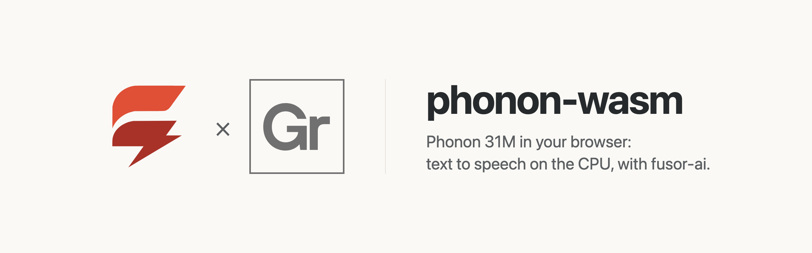
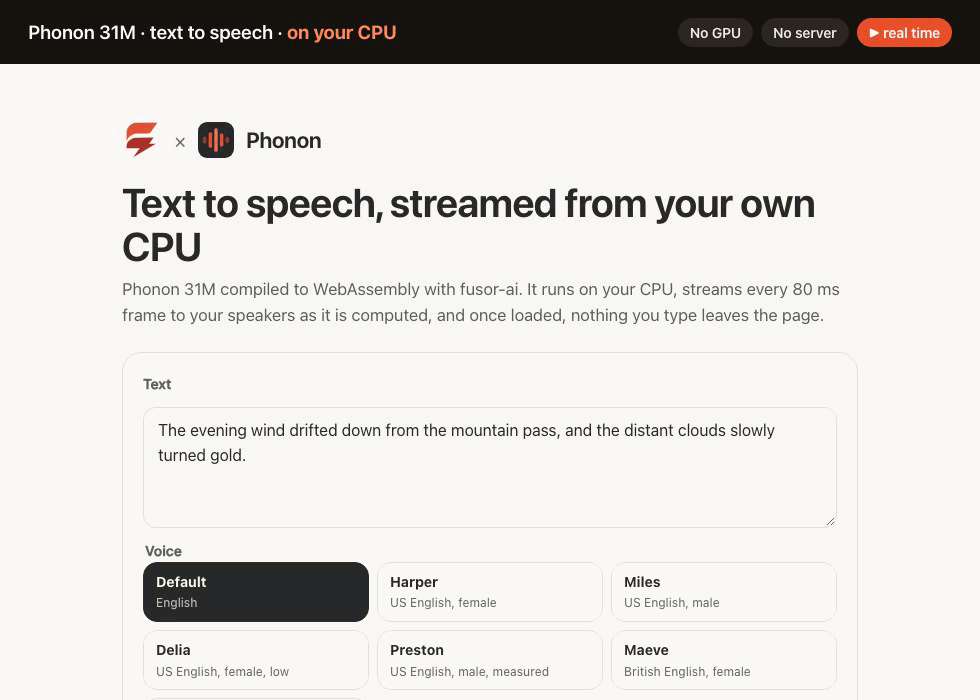

<p>
  <picture>
    <source media="(prefers-color-scheme: dark)" srcset="assets/brand/banner-dark.png">
    
  </picture>
</p>

# Text to speech in the browser, on the CPU

**[Try it in your browser](https://huggingface.co/spaces/fusorlabs/phonon-wasm)**: no install, no server. The model downloads once and runs on your CPU.

**Speech 45× faster than real time, the first audio 4 ms after you ask**, in Chrome on an Apple M4 Pro, eight threads. [Benchmarks](benchmarks.md)

<a href="https://huggingface.co/spaces/fusorlabs/phonon-wasm"></a>

Type text and hear it spoken by [Phonon 31M](https://huggingface.co/gradium/phonon-31m-en), Gradium's open-weight English text-to-speech model, computed on your own device. No server, no API key, no GPU required, and once the model has loaded, nothing you type leaves the page.

phonon-wasm is the app around the model: a [fusor](https://github.com/fusor-rs/fusor) page, the browser runtime and a native CLI. The model itself, compiled to WebAssembly, is built with [fusor-ai](https://github.com/fusor-rs/fusor-ai), the toolkit for AI runtimes in Rust and WebAssembly, from the published weights.

**In development · v0.1**: this is experimental software. See [status and known limitations](#status-and-known-limitations).

[Run it](#run-it-locally) · [Try it online](#try-it-online) · [How it works](#how-it-works) · [How fast is it](#how-fast-is-it) · [Benchmarks](benchmarks.md) · [Status](#status-and-known-limitations) · [Contributing](CONTRIBUTING.md)

## Run it locally

You need Rust 1.99 or newer, installed with [rustup](https://rustup.rs), Node.js 22 or newer and [`just`](https://github.com/casey/just). Then:

```sh
git clone --recurse-submodules https://github.com/fusor-rs/phonon-wasm && cd phonon-wasm
just ui
```

and open the address it prints. That's all: `just ui` installs the pinned tools (the threads toolchain with rustup; wasm-bindgen, binaryen and the fusor CLI into `.tools/`), downloads the checkpoint and six catalog voices at pinned revisions (100 MB, each file sha256-checked), compiles them into a 46.1 MB bundle, builds the four browser runtimes (a few minutes the first time, seconds after) and the page, and serves it on `http://localhost:8787` with the bundle beside it.

Press **Speak**, even while the model is still loading: the request waits and runs the moment the model is ready. Pick one of seven voices, the checkpoint's default and six from the [phonon-voices](https://huggingface.co/gradium/phonon-voices) catalog (US and British English). Audio plays from the first 80 ms frame, and **Download WAV** saves it. Every run is measured live: time to first audio, RTF, time per frame, audio length and playback gaps, and network requests since the model loaded, which stay at zero.

## Try it online

Open [phonon-wasm.fusor.build](https://phonon-wasm.fusor.build) in Chrome or Edge. The page downloads the 46 MB model once and keeps it in the browser's storage, so the next visit loads in under a second. The same page runs as a Hugging Face Space, [fusorlabs/phonon-wasm](https://huggingface.co/spaces/fusorlabs/phonon-wasm).

## More ways to run it

### Build everything from source

```sh
just build    # also downloads the checkpoint and voices (100 MB, sha256-checked) and compiles the bundle
just serve
```

`CHECKPOINT=<dir>` reuses a checkpoint you already have, and `PROFILE=f32` compiles the 162 MB full-precision bundle that `just parity` checks against the reference.

### The CLI

The CLI speaks without a browser:

```sh
target/release/phonon synth dist/model "Hello there." -o hello.wav
target/release/phonon synth dist/model "Hello there." --voice maeve -o hello.wav
```

`phonon bench` measures it and `phonon parity` compares every stage with the reference's outputs.

## How it works

- **The model runs in your tab.** The runtime is Phonon compiled to WebAssembly with fusor-ai: a 6-layer transformer reads the voice prefix and the text, a one-step flow head emits one 32-number latent per 80 ms frame, and a streaming Mimi decoder turns it into 24 kHz audio. Each frame is computed as you listen. The app bundle stores every weight matrix, the decoder's included, in 7 bits per value.
- **Audio never touches the main thread.** The engine worker posts each frame straight to an AudioWorklet, which plays the queue gaplessly; the page only draws the waveform and the numbers.
- **Threads and SIMD where the browser has them.** The page picks one of four builds: worker threads when it is cross-origin isolated, relaxed SIMD when the engine supports it, plain SIMD128 everywhere else.
- **Downloaded once, verified always.** The bundle streams in parts, each checked against its BLAKE3 hash, and stays in the browser's origin-private storage, so the next visit loads from this device in about a tenth of a second.
- **Sealed.** The runtime imports no network, storage, clock or entropy capability; fusor-ai's import check proves it on every build. The page counts its network requests during synthesis, and the count is zero.
- **A fusor page.** The form, the voices and the results are Rust signals with HTML templates; a small JavaScript module runs the engine worker and the audio worklet.

## How fast is it

On an Apple M4 Pro in Chrome, the page generates speech 10× faster than it plays on one thread and 45× faster on eight: a 6-second sentence takes about 0.6 s or 0.13 s to compute, and the first audio is ready 4–21 ms after the request. Every output transcribes with zero word errors. [benchmarks.md](benchmarks.md) has the full measurements against Gradium's own runtime, [xn-ptts](https://github.com/gradium-ai/xn-ptts), and its browser package [phonon-tts](https://www.npmjs.com/package/phonon-tts), in every configuration that runs on that machine, including the ones where we lose:

<picture>
  <source media="(prefers-color-scheme: dark)" srcset="assets/benchmarks/benchmarks-dark.png">
  
</picture>

In the browser on the CPU, phonon-wasm is faster at every thread count, with a smaller download and less memory. Natively, Gradium's `ptts` is 3.5× faster on one thread: it uses Apple's SME2 matrix units through KleidiAI, and Accelerate for f32, which WebAssembly cannot reach ([fusor-ai#1](https://github.com/fusor-rs/fusor-ai/issues/1)). Its WebGPU backend matches our best CPU result. On a busy machine, our eight-thread runs vary more than Gradium's ([fusor-ai#2](https://github.com/fusor-rs/fusor-ai/issues/2)).

## Documentation

| Guide | Covers |
| --- | --- |
| [Benchmarks](benchmarks.md) | Speed, latency, memory and intelligibility against Gradium's runtimes and other models, and how to reproduce them |
| [Contributing](CONTRIBUTING.md) | Setup, checks, moving fusor-ai, deploying |
| [AGENTS.md](AGENTS.md) | The code standard every change follows |

## Status and known limitations

phonon-wasm is v0.1 and experimental.

### Platform status

| Platform or capability | Status |
| --- | --- |
| Chrome and Edge, threads and relaxed SIMD | Headless Chrome end-to-end check (`just e2e`): queued load, voice pick, speak, transcribe, revisit |
| Browsers without relaxed SIMD (Safari, older Firefox) | SIMD128 builds, checked in Node (`just smoke`); not tested in those browsers |
| Pages without cross-origin isolation | Single-threaded builds, about 10× faster than real time on an Apple M4 Pro |
| Native CLI (macOS on Apple silicon) | Built and measured; no release archives yet |
| Phones | Not measured; the threaded builds' memory may grow to 2 GB |

**Not supported yet:**

- The rest of the phonon-voices catalog.
- Voice cloning from a recording: the checkpoint ships no audio encoder.
- Languages other than English.
- A GPU backend.

The model is Apache-2.0 (Gradium); label synthetic speech as synthetic.

## How is this different from Gradium's phonon-tts?

[phonon-tts](https://www.npmjs.com/package/phonon-tts) is Gradium's own browser build of the same model, from their Rust runtime [xn-ptts](https://github.com/gradium-ai/xn-ptts). phonon-wasm is a separate implementation on fusor-ai: the same weights, its own kernels, text normalizer and decoder layout, with every stage checked against Gradium's outputs. On the CPU in the browser it is faster and smaller; phonon-tts also runs on WebGPU, and natively Gradium's runtime is faster.

## How is this different from a cloud TTS API?

A cloud API sends your text to a server and bills per character. phonon-wasm runs on your device after a one-time download: it works offline, costs nothing per sentence, and your text never leaves the page.

## Contributing

phonon-wasm is an open source project in early development. The [contributing guide](CONTRIBUTING.md) covers the setup, checks and workflow. The page lives in `app/`; the runtime and the CLI live in fusor-ai's `models/phonon`; the model and its toolkit come from fusor-ai, its crates and browser scripts from the `vendor/fusor-ai` submodule.

phonon-wasm is built with the help of AI tools, mainly Claude Code, under the same rules the project asks of contributors: see [Using AI tools](CONTRIBUTING.md#using-ai-tools).

## License

Licensed under the [MIT License](LICENSE).
